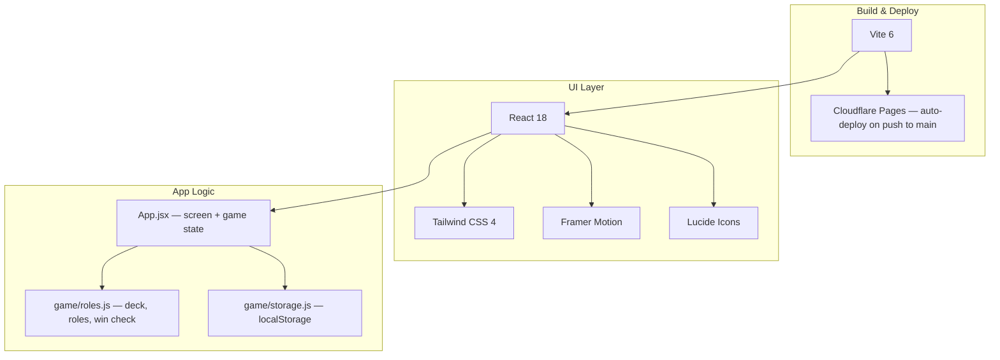
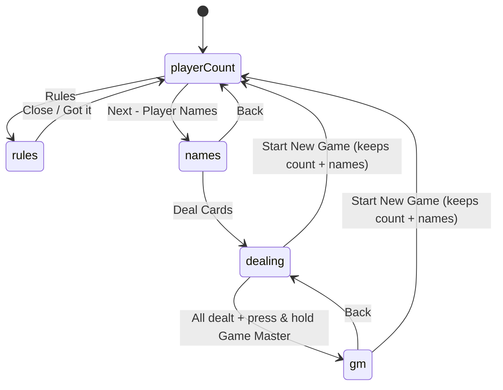
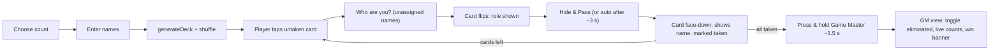
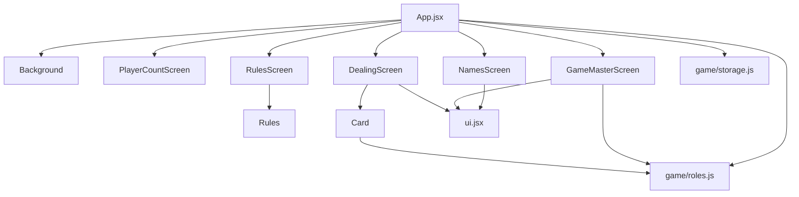
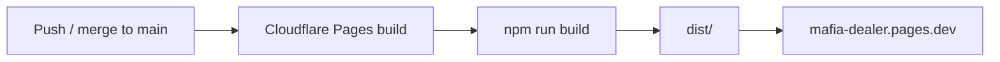
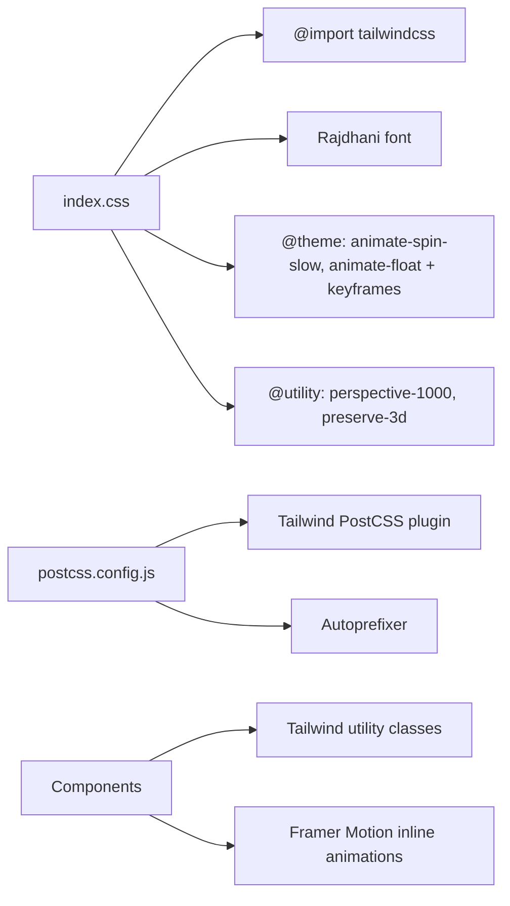

# Mafia Card Dealer — Stack & Architecture

A frontend-only single-page app for dealing Mafia role cards on one phone, with a Game Master (moderator) view.
No backend, database, or API — the last player count and names are kept in `localStorage`.

---

## High-Level Architecture



---

## Tech Stack

| Layer | Tech | Role |
|-------|------|------|
| **Framework** | React 18 | UI components and state |
| **Bundler / dev server** | Vite 6 | Fast dev, production builds |
| **Language** | JavaScript (JSX) | No TypeScript |
| **Styling** | Tailwind CSS 4 | Utility classes; custom animations via `@theme` in `index.css` |
| **CSS pipeline** | PostCSS (`@tailwindcss/postcss`) + Autoprefixer | Processes Tailwind |
| **Animations** | Framer Motion | Card flips, fades, particles, 3D tilt |
| **Icons** | Lucide React | Skull, User, HeartPulse, Search, etc. |
| **Font** | Rajdhani (Google Fonts) | Loaded in `index.css` |
| **Persistence** | `localStorage` | Last player count + names |
| **Hosting** | Cloudflare Pages | Builds `main` → https://mafia-dealer.pages.dev |

---

## Project Structure

```
Mafia/
├── index.html              # Entry HTML, mounts React at #root
├── vite.config.js          # Vite config, base '/'
├── package.json            # Dependencies & scripts
├── postcss.config.js       # Tailwind + autoprefixer
├── public/
│   ├── noise.svg           # Local grain texture for the background
│   └── favicon.svg
├── rules.png               # Legacy rules image (no longer used by the app)
└── src/
    ├── main.jsx            # React entry point
    ├── index.css           # Tailwind import, @theme animations, 3D utilities
    ├── App.jsx             # Screen routing + game state (names, deck, assignments, eliminations)
    ├── game/
    │   ├── roles.js        # ROLES visuals, generateDeck, shuffle, getWinner
    │   └── storage.js      # load/save last game, namesForCount
    └── components/
        ├── PlayerCountScreen.jsx   # Pick player count (4-20)
        ├── NamesScreen.jsx         # Game Master enters player names
        ├── DealingScreen.jsx       # Card grid, "Who are you?" picker, Hide & Pass, GM hold button
        ├── Card.jsx                # Individual role card (flip, taken-by name)
        ├── GameMasterScreen.jsx    # Roles, eliminations, live counts, win banner
        ├── RulesScreen.jsx         # Wraps Rules.jsx
        ├── Rules.jsx               # Responsive rules UI
        ├── ui.jsx                  # LiquidButton, PrimaryButton, HoldButton
        ├── Background.jsx          # Animated nebula/particles
        ├── EndScreen.jsx           # (unused)
        └── WarpTransition.jsx      # (unused)
```

---

## Screen Flow

Manual routing via React state — no React Router.



---

## Dealing Flow



### Role assignment rules

| Players | Mafia | Doctor | Detective | Villagers |
|---------|-------|--------|-----------|-----------|
| 4–6 | 1 | 1 | 1 | rest |
| 7–9 | 2 | 1 | 1 | rest |
| 10–20 | 3 | 1 | 1 | rest |

The Game Master is not a player and gets no card.

### Win conditions (Game Master view)

- **Villagers win**: every Mafia member is eliminated.
- **Mafia win**: alive Mafia ≥ alive non-Mafia.

---

## Component Dependencies



---

## Build & Deploy Pipeline



### Commands

| Command | What it does |
|---------|--------------|
| `npm run dev` | Vite dev server → `localhost:5173` |
| `npm run build` | Production build → `dist/` |
| `npm run preview` | Preview production build locally |

Deployment has no manual command: Cloudflare Pages deploys `main` automatically.

---

## Styling Architecture



---

## What Is NOT in the Stack

| Not used | Notes |
|----------|-------|
| TypeScript | Plain `.jsx` files |
| React Router | Manual `screen` state in `App.jsx` |
| Redux / Zustand | Local `useState` only |
| Backend / API | Fully static client-side app |
| Database | Only `localStorage` for last names/count |
| Testing framework | No Jest/Vitest setup |
| CSS-in-JS | Tailwind utility classes instead |

---

## Mental Model

1. **Vite** — builds and serves the app
2. **React** — UI and game state
3. **Tailwind** — look and layout
4. **Framer Motion** — motion and polish
5. **Cloudflare Pages** — hosts the built static files, deploys on push to `main`

This is a **pass-the-phone Mafia card dealer with a moderator view**, not a multiplayer online game.
