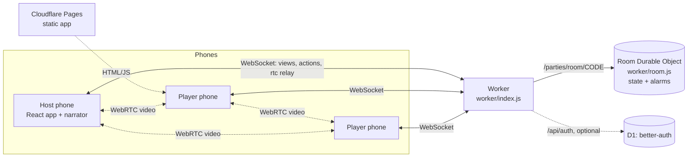

# Online rooms: architecture

Play Mafia with friends on their own phones, in one room with video. Decisions behind this design are in
[adr/](adr/README.md). Build log and run notes: [../ONLINE_PROGRESS.md](../ONLINE_PROGRESS.md).

## Overview



- **Worker** (`worker/index.js`): `/api/config`, `/api/health` (and `/health`), `/api/auth/*` (Google,
  off unless configured), `/parties/room/<CODE>` (rooms), everything else from Workers static assets.
- **Room Durable Object** (`worker/room.js`): one per 4-letter code. Storage, sockets, alarms, WebRTC relay.
  No game rules.
- **Room logic** (`src/online/roomLogic.js`): pure functions for lobby, card pick, timeline, votes and per-seat
  views; wraps the shared engine (`src/game/engine.js`).
- **Client** (`src/online/`): `OnlineApp.jsx` (screens), `useRoom.js` (PartySocket), `video.js` and
  `VideoGrid.jsx` (mesh), `names.js` (name rules), `identity.js` (guest id), `roomsHost.js` (server host).

## Flow

1. Name screen (guest) -> Home: create a room or join by code. Invite by link `/r/CODE` or QR.
2. Lobby: players mark ready; host sets language, voice, night turn, discussion and vote time; host can kick.
3. Deal: every phone sees the card spread; taken cards grey out live; hold your card to reveal your role.
4. Night: server walks Mafia, Doctor, Detective turns on alarms; cameras and mics turn off.
5. Morning, discussion, open vote on phones, win check; results; rematch or back to lobby.

Detective catch (ADR 0013): a correct Detective check eliminates that Mafia at morning, after the night kill
(the Doctor's save does not protect them), and the narrator names them at morning (voice only, no morning
text). The Detective is never told the answer at night: their phone only shows "Choice locked in", and the
server never sends the result (their "Your checks" list has names only). Then the win check: catching the
last Mafia ends the game at once (village wins, no discussion or vote); otherwise the game goes on. A wrong
guess is not announced.

## Protocol

WebSocket URL: `/parties/room/<CODE>?gid=<guest id>&name=<name>[&create=1][&fast=1]`.

Client -> server (JSON, field `t`):

| `t` | Fields | Who |
|-----|--------|-----|
| `join` | `name` | anyone (retry after a name error) |
| `rename` | `name` | member, lobby only |
| `ready` | `ready` | member, lobby |
| `settings` | `patch` (`turnSec`, `discussMin`, `voteSec`, `lang`, `voice`) | host, lobby |
| `kick` | `seat` | host |
| `start` | | host, when `canStart.ok` |
| `pick` | `index` | player, deal |
| `seen` | | player, after reveal |
| `forceNight` | | host, deal |
| `select` | `target` | player whose night turn it is |
| `vote` | `target` (seat or `skip`) | alive player, voting |
| `skipDiscussion` | | host |
| `cueDone` | `id` | host, after narration |
| `rematch`, `lobby` | | host, after the game |
| `leave` | | member; deliberate exit (see below). The server closes that seat's sockets with code 4001 |
| `rtc` | `to`, `data` | member; relayed, never stored |
| `ping` | | anyone; answered with `pong` |

Server -> client: `view` (this seat's filtered view), `error` (`action`, `code`, optional `suggestions`,
`message`), `fatal` (`code`), `rtc` (`from`, `data`), `pong`, `left` (sent right before the 4001 close
after `leave`).

### Leaving a room

The exit icon (top-right of every room screen, `aria-label="Leave room"`) asks "Leave room?" (Leave / Stay;
during the deal or a game it warns that you will be out of this game). On Leave the client sends `leave`,
stops camera/mic tracks and closes every peer connection, closes the socket for good (PartySocket does not
reconnect; close code 4001 from the server also stops it), and goes back to `/online`, so a reload does not
rejoin. The guest id and name stay in localStorage.

`R.leave(room, seat, now)` on the server, by phase:

| Phase | Effect |
|-------|--------|
| lobby | Member removed; the name is free again. They can rejoin later like anyone else. |
| deal | Member stays listed as an offline spectator (`left: true`). If they had not picked, a free card is assigned to them (the deck must match the dealt seats) and marked seen, so the night can start; when it does, they start out (dead), and the win check runs then. |
| game | Their engine player is set dead, like an eliminated player. Night picks and votes on them, and their own votes and Mafia picks, are dropped. The win check runs at once (a win jumps to END and its cue). If a vote now has every alive player's vote, it completes. Timed steps keep running, so nothing waits on the leaver. |
| END / over | Marked as left; the result does not change. |

In every phase a leaving host hands over to the longest-seated connected member (same rule as the host-offline
grace). If nobody is left, `hostSeat` is null and the next joiner becomes host. Coming back during the same
deal/game gives a spectator seat (still out). `backToLobby` drops members who left and did not come back;
`rematch` deals only connected members. Peers lose the video tile because the seat is no longer a connected
player in the next `view`. The leaver's socket close is a no-op (`disconnect` on an offline member), so
`leave` costs one storage write, with an alarm write only if the next alarm time changes. An empty room
expires through the normal idle alarm.

Close codes: `4000` bad guest id, `4003` kicked, `4004` no such room, `4009` room code already taken (the
client picks a new code).

## Data model

Room (one JSON value in DO storage, key `room`):

- `code`, `createdAt`, `lastActivity`, `hostSeat`, `status` (`lobby` | `deal` | `game`), `settings`
- `members`: `{ seat, name, ready, connected, joinedAt, offlineSince, spectator }`; `kicked`: seats
- `deal`: `{ deck, picks, seen, seats }`; `game`: engine state (player name = seat id)
- `flow`: `{ step, deadline, cue }`; `votes`, `mafiaPicks`, `cueSeq`, `hostOfflineSince`

Seat id = first 9 bytes (hex) of SHA-256(`mafia-seat:<guest id>`). Guest id: 16 to 64 of `A-Z a-z 0-9 _ -`.

Time limits: offline lobby members dropped after 60 s; host role moves on after 30 s offline; room storage
cleared after 2 h with no activity and nobody connected. 4 to 15 players.

D1 (Google sign-in only): better-auth tables in `migrations/0001_better_auth.sql`.

## Environment variables

| Name | Where | Purpose |
|------|-------|---------|
| `VITE_ROOMS_HOST` | Pages build | Room server host override. Unset: pages on `mafia-dealer.pages.dev` / `*.mafia-dealer.pages.dev` use the deployed Worker (`DEFAULT_WORKER_HOST` in `src/online/roomsHost.js`); everywhere else same origin. |
| `ALLOWED_ORIGINS` | Worker var | Extra browser origins, comma separated. Pages and its previews are built in. |
| `TURN_URLS`, `TURN_USERNAME`, `TURN_CREDENTIAL` | Worker var/secret | TURN relay for strict NATs. Without it: public STUN only. |
| `GOOGLE_CLIENT_ID`, `GOOGLE_CLIENT_SECRET` | Worker secret | Google sign-in (off when missing). |
| `BETTER_AUTH_SECRET` | Worker secret | Session signing, 32+ random characters. |
| `BETTER_AUTH_URL` | Worker var (optional) | Public base URL for auth callbacks. |
| `ADMIN_TOKEN` | Worker secret | Key for `/admin` usage stats (32+ random characters). Unset: `/api/admin/stats` always 401. |
| `CF_ACCOUNT_ID`, `CF_ANALYTICS_TOKEN` | Worker secret | Read side of usage stats: account id and an API token with **Account Analytics: Read** only. |
| `USAGE` | Worker binding | Analytics Engine dataset `mafia_usage` (in `wrangler.jsonc`), written by the Room. |

Local dev reads secrets from `.dev.vars` (git-ignored).

## Deploy

```bash
npx wrangler login            # or CLOUDFLARE_API_TOKEN + CLOUDFLARE_ACCOUNT_ID in the environment
npm run deploy                # vite build && wrangler deploy -> https://mafia-dealer.<subdomain>.workers.dev
```

- The Cloudflare account needs a workers.dev subdomain (created on first visit to Workers & Pages, or by API).
- Pages keeps building `npm run build` (static, `NO_WORKER=1`). Its `/online` connects to the deployed
  Worker automatically (no Pages settings needed); set `VITE_ROOMS_HOST` only to point it elsewhere.
- Google sign-in: create an OAuth web client (redirect `https://<host>/api/auth/callback/google`),
  `npx wrangler d1 create mafia-auth`, uncomment `d1_databases` in `wrangler.jsonc` with the id,
  `npm run db:migrate`, then `wrangler secret put` the `GOOGLE_*` and `BETTER_AUTH_SECRET` values.
  Full steps: [../ONLINE_PROGRESS.md](../ONLINE_PROGRESS.md#enable-google-sign-in-later).

## Usage stats (admin only)

The Room writes one anonymous Analytics Engine data point per event: `room_create`, `join` (a guest new to
that room, not a reconnect), `game_start` (deal -> game), `game_end` (reaching END). Each point holds the
room code, the event, the day (Asia/Kolkata), the player count and, for joins, a salted hash of the seat id.
No names, guest secrets or seat ids are written; e2e rooms (`fast=1`) are not counted. Writes go to
Analytics Engine, not Durable Object storage, so they add no `rows_written`. Details: ADR 0014.

`https://<worker-host>/admin` asks for the admin key, keeps it in `sessionStorage` only, and shows the last
30 days per day (unique guests, joins, rooms created, games started/finished, avg players per game) plus
totals. The page carries no data; `GET /api/admin/stats` needs `Authorization: Bearer <ADMIN_TOKEN>`
(constant-time compare) and answers 401 otherwise. Both are `noindex` and `no-store`. Only the Worker host
serves `/admin` (the Pages site does not).

```bash
openssl rand -base64 32 | npx wrangler secret put ADMIN_TOKEN
echo <account id> | npx wrangler secret put CF_ACCOUNT_ID
npx wrangler secret put CF_ANALYTICS_TOKEN      # token with Account > Account Analytics > Read
curl -H "Authorization: Bearer <ADMIN_TOKEN>" https://<worker-host>/api/admin/stats
```

## Health check

```bash
curl https://<worker-host>/api/health
# {"ok":true,"version":"0.0.0","commit":"f9ad1b7","time":"...","rooms":{"ok":true,"ms":9},"google":false,"turn":false}
```

`ok` is false (HTTP 503) when the Durable Object ping fails. `commit` is the git commit the deploy was built from.

## Testing

```bash
npm test                                              # Vitest unit tests (173 at f9ad1b7)
npm run dev                                           # app + Worker + DO locally (workerd)
node e2e/online-protocol.mjs http://localhost:5173    # 5 headless sockets: duplicate name, reconnect, full game
BASE_URL=http://localhost:5173 node e2e/online.e2e.mjs  # 5 Chrome players with fake cameras; screenshots to SHOTS
```

- Both e2e scripts also run against a deployed URL (the browser one adds `?debug=1` to read each player's view).
- `TURN_URL=turn:host:port?transport=tcp` makes the browser e2e use a TURN server, for machines whose
  Chrome blocks direct WebRTC.
- Measured on 2026-10-25: live protocol test 3 of 3 runs OK (games of about 21 to 24 s in fast mode);
  live 5-browser e2e OK in 47 s.

## Known limits

- Mesh video is practical for about 6 to 8 players; no TURN by default.
- Narration audio plays on the host phone only (ADR 8).
- Google sign-in is a stub; linking a Google account to a guest seat is not built.
- `partyserver` is pre-1.0 (pinned).
