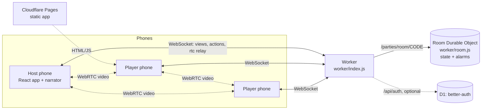

# Online rooms: architecture

Play Mafia with friends on their own phones, in one room with video. Decisions behind this design are in
[adr/](adr/README.md). Build log and run notes: [../ONLINE_PROGRESS.md](../ONLINE_PROGRESS.md).

## Overview



- **Worker** (`worker/index.js`): `/api/config`, `/api/health` (and `/health`), `/api/auth/*` (Google,
  off unless configured), `/parties/room/<CODE>` (rooms), everything else from Workers static assets.
- **Room Durable Object** (`worker/room.js`): one per 4-letter code. Storage, sockets, alarms, WebRTC relay.
  No game rules.
- **Room logic** (`src/online/roomLogic.js`): pure functions for lobby, card pick, timeline, votes and per-seat
  views; wraps the shared engine (`src/game/engine.js`).
- **Client** (`src/online/`): `OnlineApp.jsx` (screens), `useRoom.js` (PartySocket), `video.js` and
  `VideoGrid.jsx` (mesh), `names.js` (name rules), `identity.js` (guest id), `roomsHost.js` (server host).

## Flow

1. Name screen (guest) -> Home: create a room or join by code. Invite by link `/r/CODE` or QR.
2. Lobby: players mark ready; host sets language, voice, night turn, discussion and vote time; host can kick.
3. Deal: every phone sees the card spread; taken cards grey out live; hold your card to reveal your role.
4. Night: server walks Mafia, Doctor, Detective turns on alarms; cameras and mics turn off.
5. Morning, discussion, open vote on phones, win check; results; rematch or back to lobby.

## Protocol

WebSocket URL: `/parties/room/<CODE>?gid=<guest id>&name=<name>[&create=1][&fast=1]`.

Client -> server (JSON, field `t`):

| `t` | Fields | Who |
|-----|--------|-----|
| `join` | `name` | anyone (retry after a name error) |
| `rename` | `name` | member, lobby only |
| `ready` | `ready` | member, lobby |
| `settings` | `patch` (`turnSec`, `discussMin`, `voteSec`, `lang`, `voice`) | host, lobby |
| `kick` | `seat` | host |
| `start` | | host, when `canStart.ok` |
| `pick` | `index` | player, deal |
| `seen` | | player, after reveal |
| `forceNight` | | host, deal |
| `select` | `target` | player whose night turn it is |
| `vote` | `target` (seat or `skip`) | alive player, voting |
| `skipDiscussion` | | host |
| `cueDone` | `id` | host, after narration |
| `rematch`, `lobby` | | host, after the game |
| `rtc` | `to`, `data` | member; relayed, never stored |
| `ping` | | anyone; answered with `pong` |

Server -> client: `view` (this seat's filtered view), `error` (`action`, `code`, optional `suggestions`,
`message`), `fatal` (`code`), `rtc` (`from`, `data`), `pong`.

Close codes: `4000` bad guest id, `4003` kicked, `4004` no such room, `4009` room code already taken (the
client picks a new code).

## Data model

Room (one JSON value in DO storage, key `room`):

- `code`, `createdAt`, `lastActivity`, `hostSeat`, `status` (`lobby` | `deal` | `game`), `settings`
- `members`: `{ seat, name, ready, connected, joinedAt, offlineSince, spectator }`; `kicked`: seats
- `deal`: `{ deck, picks, seen, seats }`; `game`: engine state (player name = seat id)
- `flow`: `{ step, deadline, cue }`; `votes`, `mafiaPicks`, `cueSeq`, `hostOfflineSince`

Seat id = first 9 bytes (hex) of SHA-256(`mafia-seat:<guest id>`). Guest id: 16 to 64 of `A-Z a-z 0-9 _ -`.

Time limits: offline lobby members dropped after 60 s; host role moves on after 30 s offline; room storage
cleared after 2 h with no activity and nobody connected. 4 to 15 players.

D1 (Google sign-in only): better-auth tables in `migrations/0001_better_auth.sql`.

## Environment variables

| Name | Where | Purpose |
|------|-------|---------|
| `VITE_ROOMS_HOST` | Pages build | Room server host override. Unset: pages on `mafia-dealer.pages.dev` / `*.mafia-dealer.pages.dev` use the deployed Worker (`DEFAULT_WORKER_HOST` in `src/online/roomsHost.js`); everywhere else same origin. |
| `ALLOWED_ORIGINS` | Worker var | Extra browser origins, comma separated. Pages and its previews are built in. |
| `TURN_URLS`, `TURN_USERNAME`, `TURN_CREDENTIAL` | Worker var/secret | TURN relay for strict NATs. Without it: public STUN only. |
| `GOOGLE_CLIENT_ID`, `GOOGLE_CLIENT_SECRET` | Worker secret | Google sign-in (off when missing). |
| `BETTER_AUTH_SECRET` | Worker secret | Session signing, 32+ random characters. |
| `BETTER_AUTH_URL` | Worker var (optional) | Public base URL for auth callbacks. |

Local dev reads secrets from `.dev.vars` (git-ignored).

## Deploy

```bash
npx wrangler login            # or CLOUDFLARE_API_TOKEN + CLOUDFLARE_ACCOUNT_ID in the environment
npm run deploy                # vite build && wrangler deploy -> https://mafia-dealer.<subdomain>.workers.dev
```

- The Cloudflare account needs a workers.dev subdomain (created on first visit to Workers & Pages, or by API).
- Pages keeps building `npm run build` (static, `NO_WORKER=1`). Its `/online` connects to the deployed
  Worker automatically (no Pages settings needed); set `VITE_ROOMS_HOST` only to point it elsewhere.
- Google sign-in: create an OAuth web client (redirect `https://<host>/api/auth/callback/google`),
  `npx wrangler d1 create mafia-auth`, uncomment `d1_databases` in `wrangler.jsonc` with the id,
  `npm run db:migrate`, then `wrangler secret put` the `GOOGLE_*` and `BETTER_AUTH_SECRET` values.
  Full steps: [../ONLINE_PROGRESS.md](../ONLINE_PROGRESS.md#enable-google-sign-in-later).

## Health check

```bash
curl https://<worker-host>/api/health
# {"ok":true,"version":"0.0.0","commit":"f9ad1b7","time":"...","rooms":{"ok":true,"ms":9},"google":false,"turn":false}
```

`ok` is false (HTTP 503) when the Durable Object ping fails. `commit` is the git commit the deploy was built from.

## Testing

```bash
npm test                                              # Vitest unit tests (173 at f9ad1b7)
npm run dev                                           # app + Worker + DO locally (workerd)
node e2e/online-protocol.mjs http://localhost:5173    # 5 headless sockets: duplicate name, reconnect, full game
BASE_URL=http://localhost:5173 node e2e/online.e2e.mjs  # 5 Chrome players with fake cameras; screenshots to SHOTS
```

- Both e2e scripts also run against a deployed URL (the browser one adds `?debug=1` to read each player's view).
- `TURN_URL=turn:host:port?transport=tcp` makes the browser e2e use a TURN server, for machines whose
  Chrome blocks direct WebRTC.
- Measured on 2026-10-25: live protocol test 3 of 3 runs OK (games of about 21 to 24 s in fast mode);
  live 5-browser e2e OK in 47 s.

## Known limits

- Mesh video is practical for about 6 to 8 players; no TURN by default.
- Narration audio plays on the host phone only (ADR 8).
- Google sign-in is a stub; linking a Google account to a guest seat is not built.
- `partyserver` is pre-1.0 (pinned).
